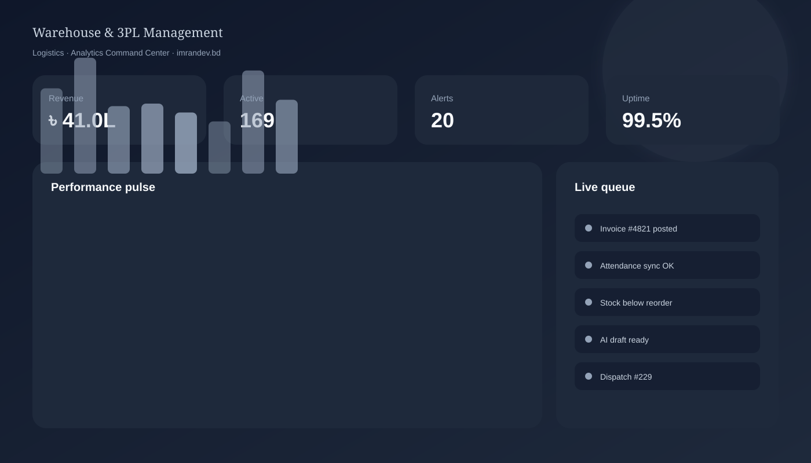
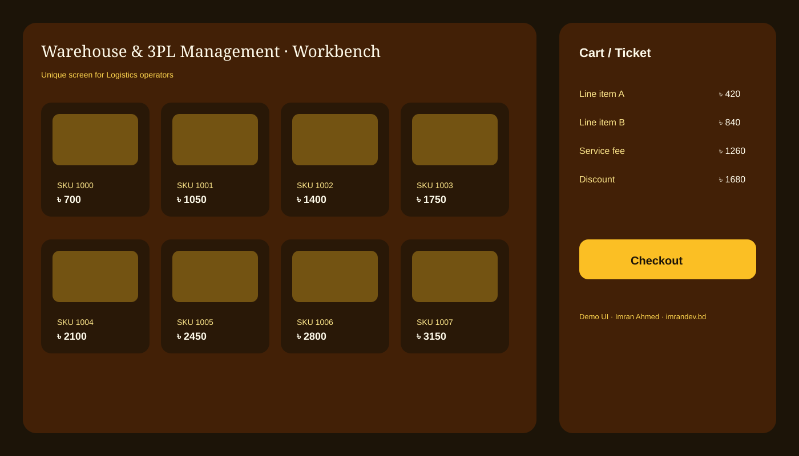
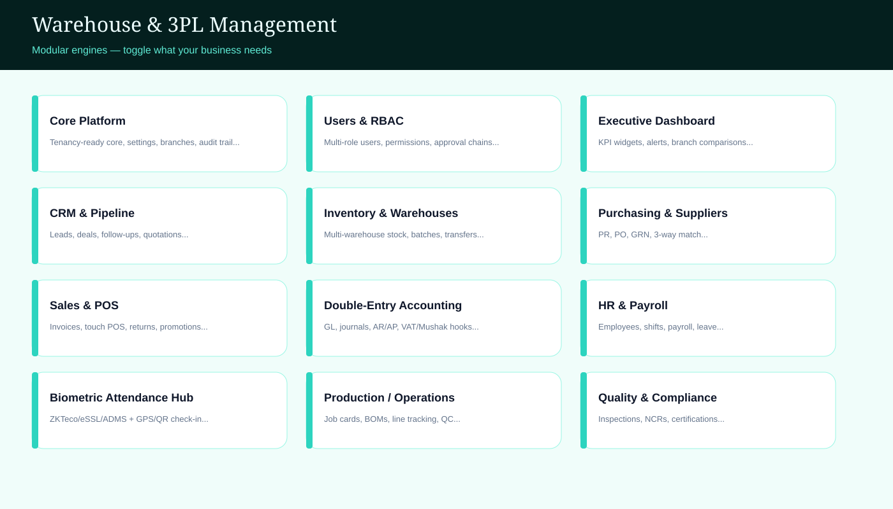
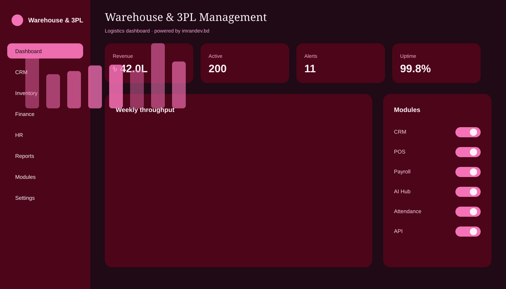

# Warehouse & 3PL Management

<p align="center">
  
</p>

> World-class modular **Laravel 12 + Filament** business OS for **Logistics** — authored by **Imran Ahmed** ([imrandev.bd](https://imrandev.bd)).

<p align="center">
  
  
</p>

<p align="center">
  <a href="https://imrandev.bd/applications/warehouse-3pl-management"></a>
  
  
  
  
</p>

---

## Why Warehouse & 3PL Management wins

3PL WMS for inbound ASN, putaway, pick/pack, billing by storage, and client portals.

This is a **complete modular business solution**: enable only the engines you need, keep the rest off, and grow into a full ERP without rewriting the platform.

### Business opportunity & time savings

| Outcome | Conservative estimate |
|---|---|
| Hours saved / staff / week | **~22 hours** |
| Typical team impacted | **12+ roles** |
| Annual hours recovered | **~13,728 hours** |
| Illustrative annual value (BD ops) | **৳ 6,782,000+** |
| Go-live vs custom greenfield | **Weeks, not 6–18 months** |

---

## Product screens (unique to this app)

| Executive dashboard | Public landing | Module matrix | Operator workbench |
|---|---|---|---|
|  |  |  |  |



---

## Architecture

- Laravel 12 + Filament admin panels
- Runtime module registry (`config/modules.php`)
- Multi-type users (Spatie permission roles)
- Public marketing + feature pages
- Demo seed data for every major role
- Author packages: [drutogoti](https://packagist.org/packages/imrandevbd/drutogoti), [laravel-admin-panel](https://packagist.org/packages/imrandevbd/laravel-admin-panel), [laravel-ai-catalog](https://packagist.org/packages/imrandevbd/laravel-ai-catalog), [laravel-ai-hub](https://packagist.org/packages/imrandevbd/laravel-ai-hub), [laravel-attendance-hub](https://packagist.org/packages/imrandevbd/laravel-attendance-hub), [laravel-unicode-pdf](https://packagist.org/packages/imrandevbd/laravel-unicode-pdf), [laravel-universal-slug](https://packagist.org/packages/imrandevbd/laravel-universal-slug)

> **GitHub Actions:** intentionally **disabled** for this project (no CI workflows).

---

## Modules (ON / OFF)

| Key | Module | Capability | Default |
|---|---|---|---|
| `core` | **Core Platform** | Tenancy-ready core, settings, branches, audit trail | ON |
| `users_rbac` | **Users & RBAC** | Multi-role users, permissions, approval chains | ON |
| `dashboard` | **Executive Dashboard** | KPI widgets, alerts, branch comparisons | ON |
| `crm` | **CRM & Pipeline** | Leads, deals, follow-ups, quotations | ON |
| `inventory` | **Inventory & Warehouses** | Multi-warehouse stock, batches, transfers | ON |
| `purchasing` | **Purchasing & Suppliers** | PR, PO, GRN, 3-way match | ON |
| `sales_pos` | **Sales & POS** | Invoices, touch POS, returns, promotions | ON |
| `accounting` | **Double-Entry Accounting** | GL, journals, AR/AP, VAT/Mushak hooks | ON |
| `hr_payroll` | **HR & Payroll** | Employees, shifts, payroll, leave | ON |
| `attendance` | **Biometric Attendance Hub** | ZKTeco/eSSL/ADMS + GPS/QR check-in | ON |
| `production` | **Production / Operations** | Job cards, BOMs, line tracking, QC | ON |
| `quality` | **Quality & Compliance** | Inspections, NCRs, certifications | ON |
| `logistics` | **Logistics & Dispatch** | Challans, fleets, delivery tickets | ON |
| `documents` | **Documents & Unicode PDF** | Bangla/English invoices, challans, reports | ON |
| `ai_assistant` | **AI Hub Assistant** | Multi-provider AI drafts, insights, OCR assist | ON |
| `ai_catalog` | **AI Catalog Ingest** | Photo/URL/voice/bulk product & record intake | OFF |
| `ecommerce` | **Ecommerce / Portal** | Customer portal, online orders, tracking | OFF |
| `notifications` | **SMS / WhatsApp / Email** | Transactional alerts and campaigns | ON |
| `reports` | **Advanced Reports** | Exports, scheduled packs, board packs | ON |
| `api` | **Headless REST API** | Token API for mobile/partners | ON |
| `performance` | **Drutogoti Profiler** | Query/performance bottleneck detection | ON |
| `media` | **Media Studio** | Uploads, galleries, document vault | ON |
| `audit` | **Audit & Activity Log** | Immutable activity + maker-checker | ON |
| `helpdesk` | **Internal Helpdesk** | Tickets, SLAs, knowledge base | OFF |
| `routing` | **Routing & Dispatch Board** | Live board, ETA, proof of delivery | ON |
| `cod` | **COD & Settlements** | Cash-on-delivery and merchant payouts | ON |

```bash
php artisan modules:list
php artisan modules:enable crm
php artisan modules:disable ecommerce
```

---

## Demo users

| Role | Email | Password |
|---|---|---|
| Super Admin | `admin@demo.local` | `password` |
| Business Owner | `owner@demo.local` | `password` |
| Operations Manager | `manager@demo.local` | `password` |
| Accountant | `accounts@demo.local` | `password` |
| HR Officer | `hr@demo.local` | `password` |
| Floor / Counter Staff | `staff@demo.local` | `password` |
| Customer / Portal User | `customer@demo.local` | `password` |

---

## Public routes

| Route | Purpose |
|---|---|
| `/` | Landing |
| `/features` | Feature story |
| `/modules` | Module matrix |
| `/pricing` | Packaging |
| `/demo` | Credentials |
| `/docs` | Handbook |
| `/contact` | Contact |
| `/admin` | Filament panel |

---

## Quick start

```bash
cd warehouse-3pl-management
cp .env.example .env
composer install
php artisan key:generate
php artisan migrate --seed
php artisan storage:link
php artisan serve
```

Admin: http://127.0.0.1:8000/admin — `admin@demo.local` / `password`

---

## Author

**Imran Ahmed** · me@imrandev.bd · https://imrandev.bd

---

## Docker

```bash
docker compose up -d --build
```

App: http://localhost:8080 · Admin: http://localhost:8080/admin

Built & maintained by **Imran Ahmed** — [imrandev.bd/contact](https://imrandev.bd/contact)

## 🤝 Let's Connect & Collaborate

I am open to **Senior Remote Full-Stack Roles**, **AI Platform Architecture Contracts**, and **Enterprise Technical Advisory**.

**Timezone:** UTC+6 (Dhaka / Rangpur, Bangladesh) — Flexible overlap with US, UK, and European business hours.  
**Delivery Mode:** Async-ready, Slack, Discord, Jira, GitHub, and production-first accountability.

| Channel | Address / Handle | Quick Action |
|---|---|---|
| 🌐 Primary Portfolio | [imrandev.bd](https://imrandev.bd) | [Visit Site ↗](https://imrandev.bd) |
| 📦 Packagist Packages | [packagist.org/packages/imrandevbd/](https://packagist.org/packages/imrandevbd/) | [View Packages ↗](https://packagist.org/packages/imrandevbd/) |
| 💼 LinkedIn Profile | [linkedin.com/in/imranbru99](https://www.linkedin.com/in/imranbru99) | [Connect ↗](https://www.linkedin.com/in/imranbru99) |
| 🐙 GitHub Profile | [github.com/imranbru99](https://github.com/imranbru99) | [Follow ↗](https://github.com/imranbru99) |
| 💬 WhatsApp Direct | +880 1576-918420 | [Chat Now ↗](https://wa.me/8801576918420) |
| 📧 Direct Email | me@imrandev.bd | [Send Email ↗](mailto:me@imrandev.bd) |
| 🐦 X (Twitter) | [@imrandev_bd](https://x.com/imrandev_bd) | [Follow ↗](https://x.com/imrandev_bd) |
| 📺 YouTube Tech | [@ImranDevBD](https://www.youtube.com/@ImranDevBD) | [Subscribe ↗](https://www.youtube.com/@ImranDevBD) |
